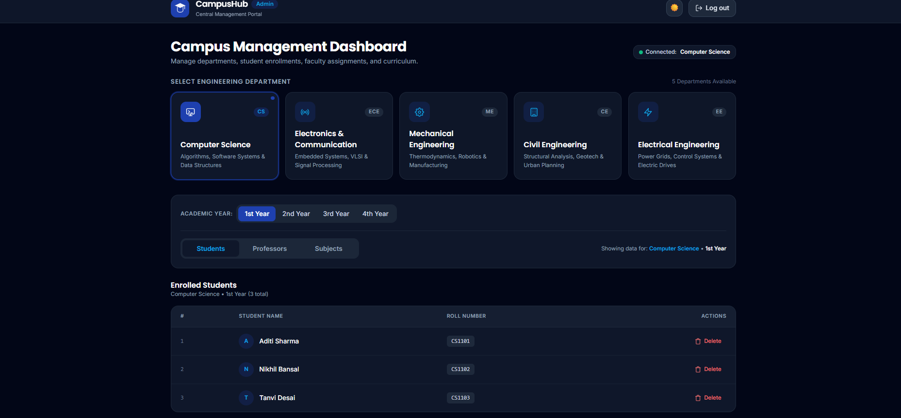
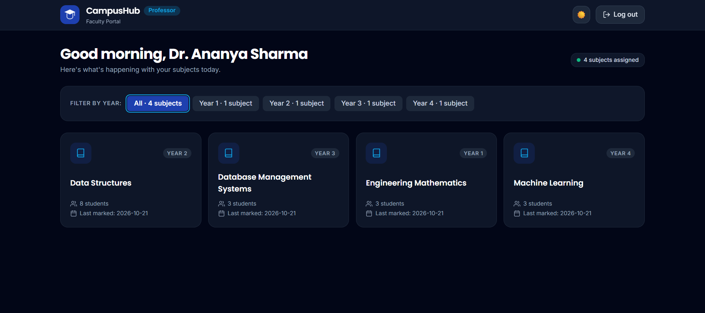
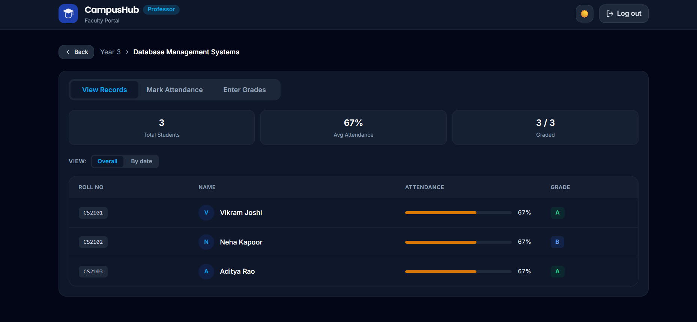
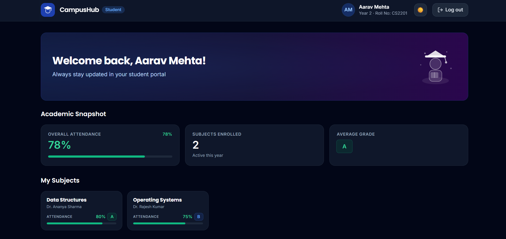
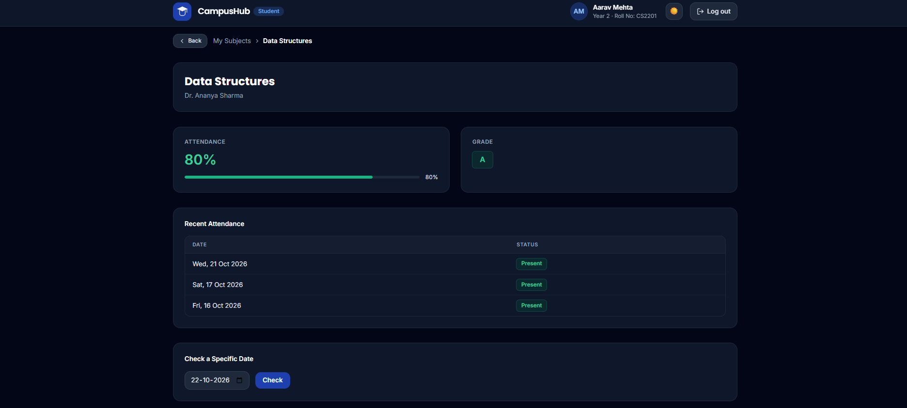
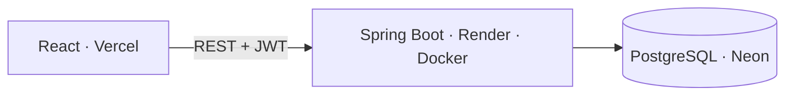
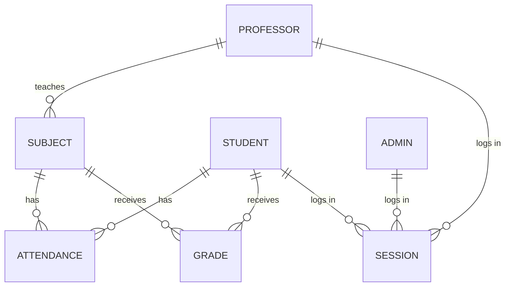

# 🚀 Campus Hub — College Management System

    

Campus Hub is a role-based college management system built around one flow: **Admin sets up the institution → Professor does the academic work → Student sees their own data.** It has three strictly separated roles, a stateless JWT auth system with revocable database-backed sessions, and it is fully deployed and live — not a localhost demo.

The backend is the heart of the project: a Spring Boot API where authentication, authorization, ownership checks, and business rules all live server-side. The React frontend is a thin client on top of it — the same API could serve a mobile app tomorrow with zero backend changes.

## 🧠 Overview

- **Admin** — manages students, professors, and subjects; assigns professors with department-match enforcement; deletes are relationship-safe (a student's records are cleaned up with them; a deleted professor's subjects survive as "unassigned")
- **Professor** — marks daily attendance and grades, but only for subjects assigned to them (ownership-checked on every request)
- **Student** — read-only view of their own subjects, attendance percentage, grades, and attendance history
- **Auth** — stateless JWT access tokens + rotating refresh sessions stored in the database, with per-role session caps
- **Errors** — one uniform JSON envelope with disciplined status codes (400 / 401 / 403 / 404 / 409)
- **Interface** — responsive React frontend with dark mode, role-specific dashboards, and time-based greetings; works from phone to desktop

## 🌐 Live Demo

**Web app — https://campus-hub-three-ebon.vercel.app**

> The backend runs on a free tier and sleeps when idle — the first request can take ~50 seconds to wake it. After that, it's fast.

**Demo logins** — shared password: `Campus@123`

| Role | Email |
|---|---|
| Admin | `admin@campushub.edu` |
| Professor | `ananya.sharma@campushub.edu` |
| Student | `aarav.mehta@campushub.edu` |

The seeded demo data spans every department and year, so each role has something real to show. Prefer your own account? **Register from the sign-up page** — any role, including Admin, can be created there.

## 📸 Screenshots

| Admin — Management Dashboard | Professor — Assigned Subjects |
|---|---|
|  |  |

| Professor — Subject Records | Student — Dashboard |
|---|---|
|  |  |

| Student — Subject Detail |
|---|
|  |

## 🗂️ Project Structure

```
Campus-Hub/
├── backend/                          # Spring Boot API (Java 21)
│   ├── Dockerfile                    # multi-stage build
│   └── src/main/java/com/example/collegeManagementSystem/collage/
│       ├── configs/                  # security chain, CORS
│       ├── controller/               # Auth, Admin, Professor, Student, Subject
│       ├── service/                  # business logic, ownership guards
│       ├── repository/               # Spring Data JPA repositories
│       ├── entity/                   # JPA entities
│       ├── dto/                      # request/response shapes (never entities)
│       ├── filters/                  # JWT auth filter, entry point, access-denied handler
│       └── advice/                   # global exception handler, ApiResponse envelope
└── Frontend/                         # React + Vite + Tailwind CSS
    └── src/
        ├── pages/                    # Login, Register, role dashboards
        ├── components/               # shared + per-role UI
        └── services/                 # API client (token handling, 401 reaction)
```

## 🏗️ Architecture



## 🗄️ Database Design



Three user tables share one mapped-superclass shape (id, name, unique email, BCrypt hash, department). **Attendance is unique per (student, subject, date)** — re-marking updates, never duplicates — and **subject.professor_id is nullable**, so subjects survive a professor's removal. No enrollment table yet: rosters derive from department + year.

## 🔄 Request Flow

What happens when a logged-in professor opens a subject's roster:

1. The request arrives with `Authorization: Bearer <access-token>`.
2. **`JwtAuthFilter`** validates the token — signature, expiry, token type — loads the user, and stamps the identity into the SecurityContext. Anything wrong → **401**. *(Authentication: who are you?)*
3. **`AuthorizationFilter`** matches the path against the role rules (`/professor/**` requires PROFESSOR). Wrong role → **403**. *(Authorization: are you allowed here?)*
4. The DispatcherServlet routes to the controller.
5. The **service layer** enforces ownership and business rules — this subject must belong to this professor; no future attendance dates; same-department assignment only.
6. The repository queries PostgreSQL, and the result returns in the uniform `ApiResponse` envelope.

## 💡 Engineering Highlights

The parts of this project with real design decisions behind them:

**1. Session management with per-role caps.**
Refresh tokens are database-backed sessions, not fire-and-forget JWTs — **Admin: 1, Professor: 3, Student: 3**, oldest evicted past the cap. Refresh rotates the session and logout deletes it, so stateless 15-minute access tokens still get real revocation.

**2. Attendance and grades are records, not checkboxes.**
Every entry is a row keyed by (student, subject, date) with a uniqueness guarantee — re-marking **upserts** instead of duplicating. That history powers pre-filled re-marking for professors, and per-subject percentages plus day-by-day history for students.

**3. An API that doesn't leak.**
Professor endpoints re-verify subject ownership on every request — being *a* professor is never enough. A student probing another department's subject gets the **identical 404** as one that doesn't exist, and login answers the same "invalid credentials" for unknown email or wrong password — no account enumeration.

**4. Purpose-built dashboards, not CRUD dumps.**
Each role's home screen is a single aggregated response in a DTO shaped for that screen — the student dashboard returns subjects, attendance %, grade, and professor name in **one call**; the admin dashboard drills department → year with live counts. Entities never cross the wire.

**5. 401 and 403 mean different things — and the frontend runs on that contract.**
Separated at the filter level with a custom `AccessDeniedHandler`; malformed bodies return 400, not an auth error. The frontend treats 401 as its only "session dead" signal — a student clicking an admin URL gets a clean 403 and stays logged in, not a forced logout.

## 🛡️ Security Model

- BCrypt password hashing; JWT claims (user id, role, token type) are signature-verified — a tampered token fails before any role check
- `HttpOnly` refresh cookie (`SameSite=None; Secure`) — usable by the browser, unreadable by scripts; CORS locked to the deployed frontend origin
- DTOs in and out — entities and password hashes never cross the wire; bean validation at the boundary, with field-level 400 messages

## 🧰 Tech Stack

**Backend** — Java 21 · Spring Boot 4 · Spring Security · Spring Data JPA · JJWT · Maven · multi-stage Docker build

**Frontend** — React · Vite · Tailwind CSS

**Infrastructure** — PostgreSQL on Neon · backend on Render (Docker) · frontend on Vercel

## ⚙️ Project Setup

**Backend** (from `backend/`):

```bash
# environment variables (DB_URL / DB_USER have the local defaults shown)
DB_URL=jdbc:postgresql://localhost:5432/collageDb
DB_USER=postgres
DB_PASSWORD=<your password>
JWT_SECRET=<a long random secret>

./mvnw spring-boot:run        # or: docker build -t campus-hub . && docker run -p 8080:8080 campus-hub
```

**Frontend** (from `Frontend/`):

```bash
npm install
npm run dev                   # talks to http://localhost:8080 unless VITE_API_BASE_URL says otherwise
```

## 🔌 API Overview

**Auth** — `POST /auth/register/{student|professor|admin}` · `POST /auth/login/{student|professor|admin}` · `POST /auth/refresh` · `POST /auth/logout`

**Admin** — `GET /admin/student?department=&year=` · `GET /admin/professor?department=` · `DELETE /admin/student/{id}` · `DELETE /admin/professor/{id}` · `POST /admin/subject` · `GET /admin/subject?department=&year=` · `GET|PUT|DELETE /admin/subject/{id}` · `PUT /admin/subject/{id}/assign?professorId=` · `DELETE /admin/subject/{id}/assign` (unassign)

**Professor** — `GET /professor/me` · `GET /professor/subjects` · `GET /professor/subjects/{id}/students` · `GET /professor/subjects/{id}/attendance?date=` · `POST /professor/attendance` · `POST /professor/grades`

**Student** — `GET /student/me` · `GET /student/subjects` · `GET /student/subjects/{id}/attendance?date=`

## 🗺️ Improvements & Roadmap

Known gaps and where this goes next:

- **Silent refresh in the frontend** — the backend rotation is ready; the client should renew on 401 and retry once instead of logging the user out at access-token expiry
- **Idempotent logout** — logout with an already-gone session should answer 200, not an error
- **Automated tests** — the API is currently verified by systematic endpoint testing (two full audit passes against the live deployment); a JUnit/MockMvc suite is the next step
- **Validation coverage** — bean validation started with registration; extend it to every request DTO
- **Real enrollment model** — rosters are currently derived from department + year; a student–subject enrollment table would support electives and mixed classes
- **Redis** — introduce Redis as a cache for hot reads (subject lists, class rosters) and as a faster session store alongside the JWT flow
- **Microservices split** — extract auth into a standalone service and separate the academic modules (subjects, attendance, grades) behind an API gateway, so each can scale and deploy independently
- **CI/CD** — a GitHub Actions pipeline running tests and deploying on merge, replacing the current push-to-deploy flow

---

**Thanks for checking out Campus Hub.**
